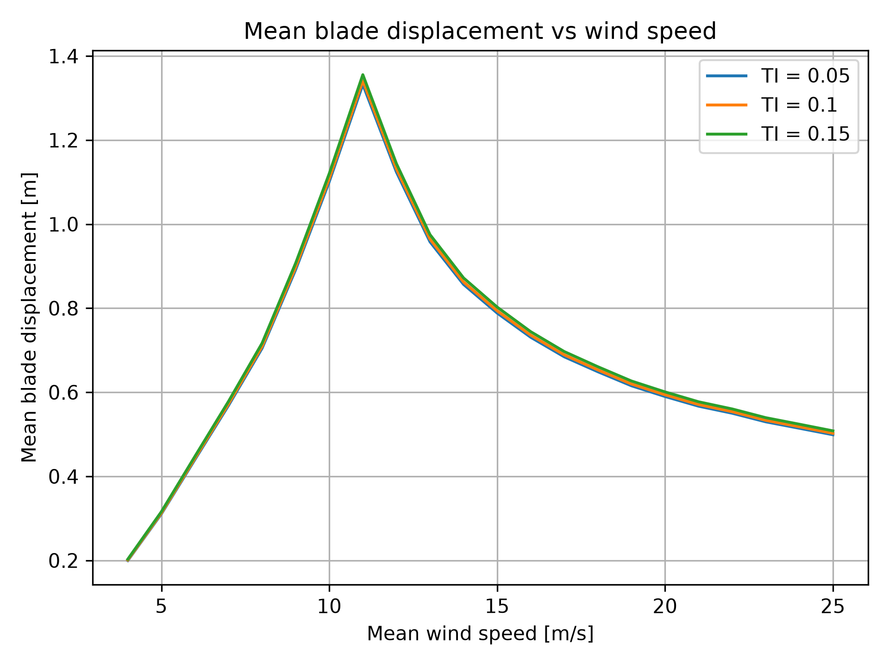
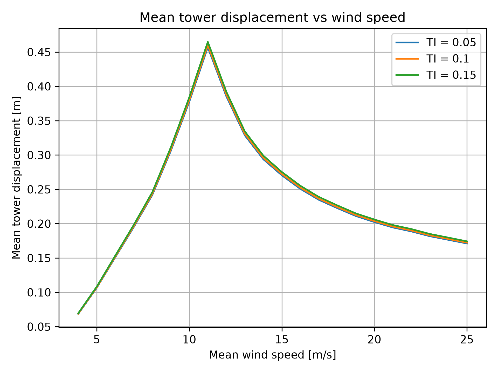
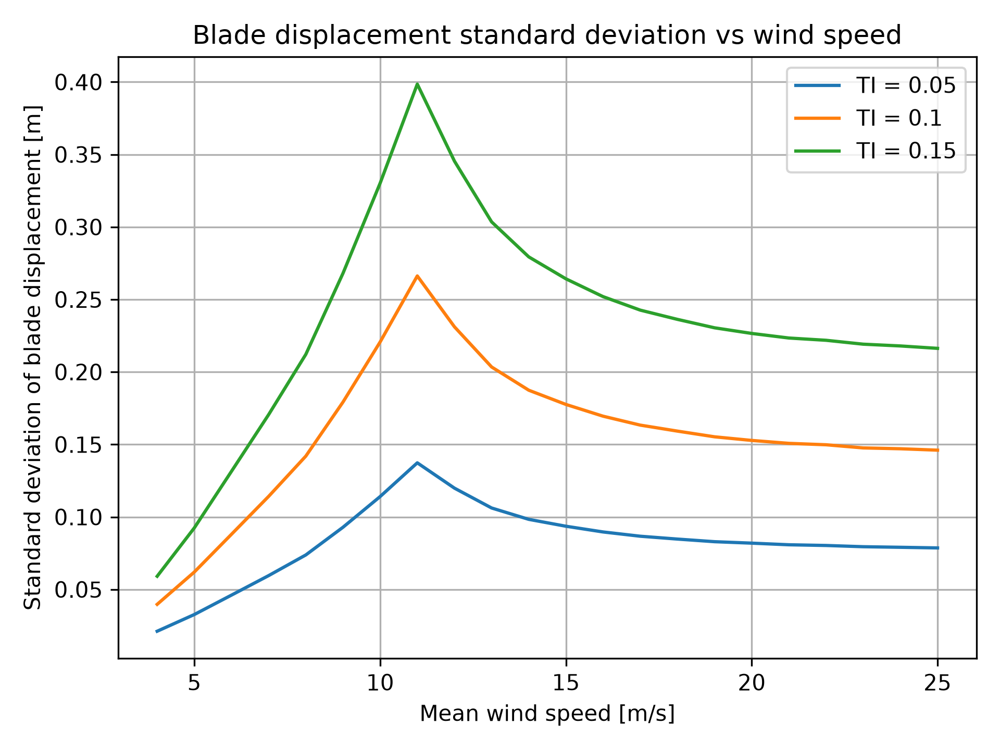
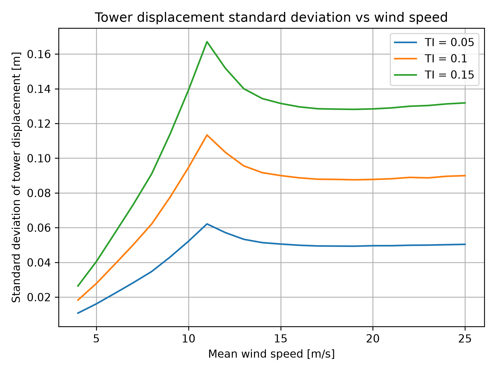
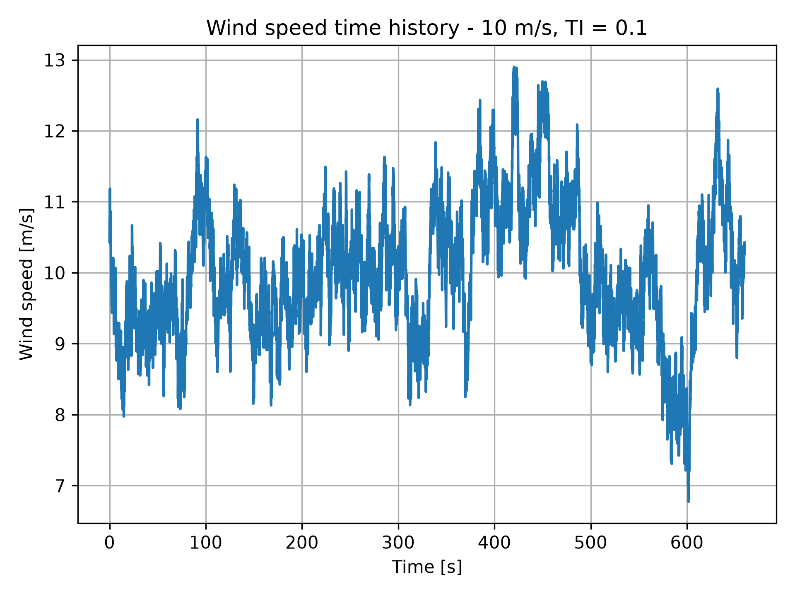
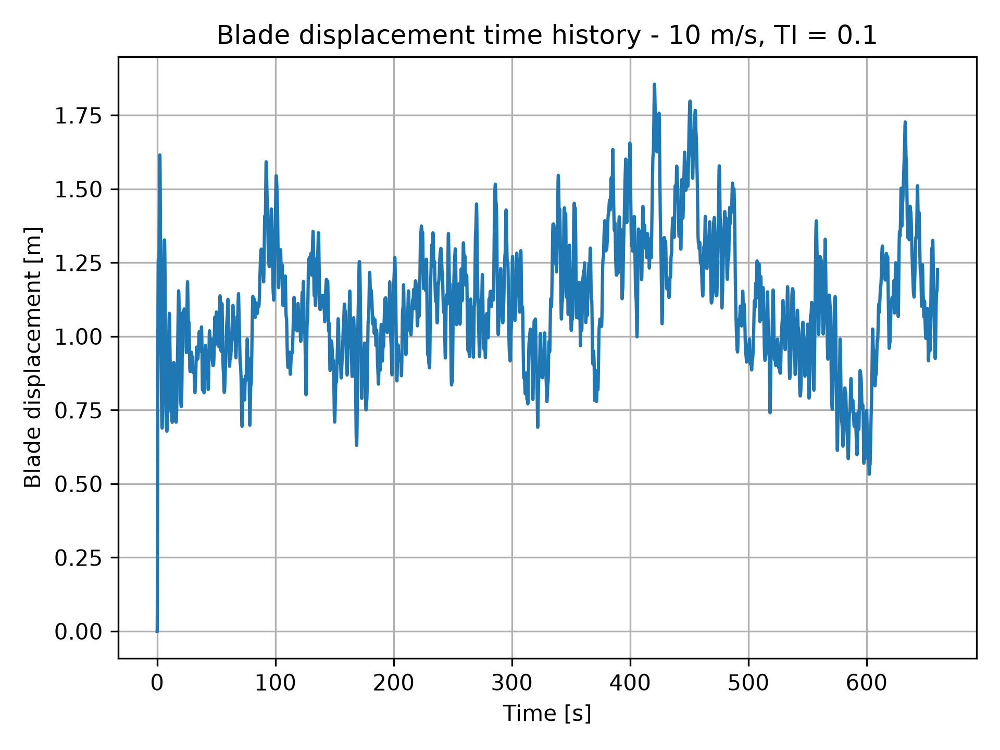
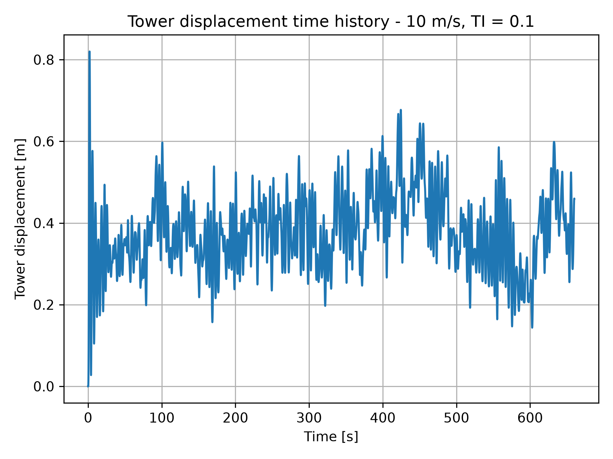

# Project 02 – Turbie

## 1. Introduction

This project investigates the dynamic response of a simplified
two-degree-of-freedom (2DOF) wind turbine model, referred to as Turbie.

The objective is to evaluate the blade and tower displacements under
different mean wind speeds and turbulence intensities.

## 2. Numerical Model

The turbine is represented by two degrees of freedom:

- x1: blade displacement
- x2: tower displacement

The equation of motion is:

$$
M\ddot{x} + C\dot{x} + Kx = F(t)
$$

The mass, damping and stiffness matrices are constructed from the
turbine parameters provided with the assignment.

The aerodynamic force is calculated as:

$$
F_{\mathrm{aero}}(t) =
\frac{1}{2}\rho C_T A
\left(u(t)-v_1\right)
\left|u(t)-v_1\right|
$$

where:

- rho is the air density.
- CT is the thrust coefficient.
- A is the rotor swept area.
- u(t) is the instantaneous wind speed.
- v1 is the blade velocity.

The rotor swept area is calculated as:

$$
A = \frac{\pi D_r^2}{4}
$$

The thrust coefficient is determined by linear interpolation from
the supplied `CT.txt` data, using the mean wind speed of each
simulation.

The equations of motion are converted into a system of first-order
ordinary differential equations and solved using
`scipy.integrate.solve_ivp`.

The initial displacements and velocities are set to zero.

## 3. Simulation Cases

The simulations cover:

- Mean wind speeds from 4 to 25 m/s, with increments of 1 m/s.
- Turbulence intensities of 0.05, 0.10 and 0.15.
- A total of 66 simulation cases.

For each simulation, the time-dependent blade and tower
displacements are calculated and saved in a text file.

The simulation outputs contain three columns:

1. Time [s]
2. Blade displacement [m]
3. Tower displacement [m]

For every turbulence intensity, the mean and standard deviation
of blade and tower displacement are calculated for all wind speeds.

The statistics are stored in separate text files for each
turbulence intensity.

## 4. Results

### 4.1 Mean Blade and Tower Displacements

The mean blade and tower displacements increase with mean wind
speed up to approximately 11 m/s, where their maximum values occur.

Above 11 m/s, both mean displacements decrease as the mean wind
speed increases.

At 11 m/s, the mean blade displacement ranges from approximately
1.332 m for TI = 0.05 to 1.355 m for TI = 0.15.

The corresponding mean tower displacement ranges from approximately
0.457 m to 0.465 m.

These results indicate that turbulence intensity has a relatively
small influence on mean displacement in the simplified model.





### 4.2 Standard Deviation of Displacements

The standard deviation of both blade and tower displacement
increases substantially with turbulence intensity.

At a mean wind speed of 11 m/s, the following results were obtained:

| TI | Blade std [m] | Tower std [m] |
|---|---:|---:|
| 0.05 | 0.1373 | 0.0622 |
| 0.10 | 0.2662 | 0.1134 |
| 0.15 | 0.3985 | 0.1671 |

Increasing turbulence intensity from 0.05 to 0.15 increases the
blade displacement standard deviation by approximately 2.9 times
and the tower displacement standard deviation by approximately
2.7 times.

This demonstrates the strong influence of wind turbulence on the
fluctuating structural response.





### 4.3 Time Histories

Wind speed, blade displacement and tower displacement time histories
are presented for the selected simulation case:

- Mean wind speed: 10 m/s
- Turbulence intensity: 0.10

The wind speed time history shows the turbulent fluctuations around
the mean wind speed.

The blade and tower displacement time histories illustrate the
time-dependent structural response to the aerodynamic loading.







## 5. Discussion

The simulation results show that mean wind speed and turbulence
intensity affect different aspects of the turbine response.

### 5.1 Influence of Mean Wind Speed

The mean wind speed strongly influences the average structural
displacement.

For all three turbulence intensities, the maximum mean blade
and tower displacements occur at approximately 11 m/s.

The mean displacements decrease at higher wind speeds.

This behavior is consistent with the variation of the prescribed
thrust coefficient in the simplified aerodynamic model.

### 5.2 Influence of Turbulence Intensity

Turbulence intensity has a relatively small effect on the mean
displacements but a much stronger influence on their standard
deviations.

Higher turbulence intensity produces larger displacement
fluctuations for both the blade and tower degrees of freedom.

The largest standard deviations occur around 11 m/s for all
three turbulence intensities.

### 5.3 Model Limitations

The Turbie model is a simplified two-degree-of-freedom representation
of a wind turbine.

The model uses a prescribed thrust coefficient and does not include
all aerodynamic, structural and control-system effects present in
a real wind turbine.

Therefore, the conclusions apply to the implemented model and the
supplied wind data rather than to a fully detailed turbine model.

## 6. Project Structure

The project contains the following files and directories:

- `main.py` – runs the simulations, calculates statistics and generates figures.
- `turbie_mod.py` – contains the functions used for the numerical model.
- `inputs/` – contains turbine parameters, thrust coefficient data and wind files.
- `outputs/` – contains simulation results, statistics and figures.
- `README.md` – project description and discussion of results.

The `outputs/` directory contains:

- 66 simulation result files.
- 3 statistics files.
- 7 PNG figures.

## 7. Running the Project

The project requires Python and the following libraries:

- NumPy
- SciPy
- Matplotlib

To execute all 66 simulations, calculate the statistics and generate
the figures, run:

```bash
python main.py
```

The results and figures are saved in the `outputs/` directory.

## 8. Conclusion

A total of 66 simulations were successfully completed for the
simplified Turbie 2DOF wind turbine model.

The results indicate that the largest mean blade and tower
displacements occur near 11 m/s.

Increasing turbulence intensity produces substantially larger
displacement fluctuations, while its influence on the mean
displacements remains relatively small.

The project demonstrates how numerical simulation can be used
to investigate the influence of wind conditions on the dynamic
response of a simplified wind turbine model.
